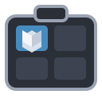
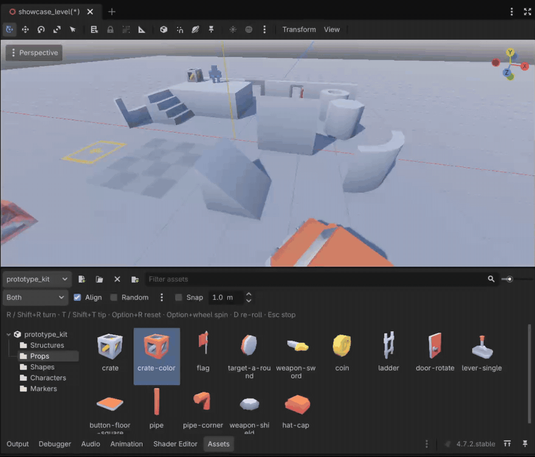

#  Asset Drawer

A small Godot 4.7+ editor addon for level building. Organize scenes and models into libraries, pick one from a thumbnail drawer, and click to stamp copies onto colliders or visible meshes in the 3D viewport.

**Status: alpha (0.1.0).** It's in daily use on one game project and has a headless test suite, but the library format, the toolbar and the default keys may still change before 1.0. Issues and pull requests are welcome; please say which Godot version and platform you're on.

## What it does

- **Libraries.** A library is a `.tres` resource saved anywhere in your project, with nested folders. Assets are tracked by uid, so moving or renaming files doesn't break anything, and a deleted asset shows as a marked tile with its last path rather than vanishing. Libraries are plain resources: commit them, diff them, share them.
- **The drawer.** An **Assets** dock that starts in the bottom panel and can be moved to a side dock or floated. Rendered thumbnails, a text filter, drag-in from the FileSystem dock, drag-to-reorder, and a folder tree. Tiles can also be dragged into the 3D viewport or the Scene dock like files.
- **Placement.** Click a tile and a see-through ghost follows the mouse over your scene. Each click stamps one copy as one undo step, parented under the node you had selected. It lands on colliders, on visible meshes (so geometry without collision works too), or whichever is nearer, and rests on the surface by its visible bounds, so an asset with a centred origin isn't half buried.
- **Shaping each copy.** Align to the surface normal, turn and tip in 90° steps, spin with the wheel, random yaw and scale per copy, and grid snap that stays on the surface you hit.

## Requirements

Godot 4.7 or later. Pure GDScript, editor-only, no C# or GDExtension. Developed on macOS; the keys use Option on macOS and Alt elsewhere.

## Install

1. Copy `addons/asset_drawer/` into your project's `addons/` folder. From a clone of this repo, `tools/sync_to.sh /path/to/your/project` does that and removes stale files from an older copy.
2. Open **Project → Project Settings → Plugins** and enable **Asset Drawer**.
3. An **Assets** dock appears in the bottom panel. Drag its tab to a side dock or float it, like any other dock.

## Quick start

1. In the Assets dock, click **New library…** and save a `.tres` somewhere in your project, say `res://libraries/props.tres`. The file name is the library's name.
2. Drag scenes or models from the FileSystem dock onto the grid. Drop a folder to add every scene inside it. Right-click the folder tree on the left for **New Folder**, **Rename** and **Delete Folder**; a new folder opens for renaming straight away, and a double-click renames a folder. Drop tiles or files onto a folder to file them there.
3. Open a 3D scene and click a tile. The tile tints, a ghost follows your mouse in the viewport, and each left click places a copy. Press **Esc**, or click the tile again, to stop.
4. Copies go under the node you had selected when you clicked the tile, or under the scene root. Every placement is one entry in the scene's undo history.

Anything the editor imports as a `PackedScene` can go in a library: `.tscn`, `.scn`, `.glb`, `.gltf`, `.fbx`, `.blend`. Other files are refused with a warning.

## While placing

A second toolbar row appears while a tile is armed.

| Control | Effect |
| --- | --- |
| **Hit mode** | What the ray lands on: **Colliders**, **Meshes** (visible `MeshInstance3D`s, no collision needed) or **Both** (the nearer wins). |
| **Align** | Tilt the copy so its up axis follows the surface normal. Off, copies stay upright, and stand off a wall by their own depth. |
| **Random** and **⋮** | Give each copy a random yaw (0 to N°) and uniform scale (min to max). The ghost always shows the next roll. |
| **Snap** and step | Snap the hit point to a world grid, then slide it back onto the surface, so a floor keeps its height and a wall keeps its depth. |

The keys, which work whenever the mouse is over a 3D viewport:

| Key | Effect |
| --- | --- |
| **R** / **Shift+R** | Turn 90° left / right around the surface's up |
| **T** / **Shift+T** | Tip 90° forward / sideways; T twice flips the copy over |
| **Alt+R** | Reset the turn and tips |
| **Alt+wheel** | Spin 15° per notch, 5° with Shift as well |
| **D** | Re-roll the random yaw and scale |
| **Esc** | Stop placing |
| **Alt+click** | Passes through to the viewport |

Right-click and the plain wheel are left alone, so freelook and zoom still work. The keys are editor shortcuts under `asset_drawer/` in **Editor Settings → Shortcuts**, so you can rebind them. The toolbar settings are remembered per project in the editor's metadata; nothing is written to `project.godot`.

## Libraries on disk

A library is an `AssetDrawerLibrary` resource: a tree of `AssetDrawerFolder`s, each holding `AssetDrawerEntry` sub-resources that store a `uid://` and the path the asset was last seen at. A scene written by hand that has no uid yet is stored by path and switches to its uid once it gets one. Renaming the `.tres` in the FileSystem dock renames the library.

Thumbnails are rendered in an offscreen viewport and cached as PNGs in `.godot/editor/asset_drawer_thumbnails/`, keyed by the asset's modified time. An edited asset re-renders on its own; a change to only a texture it uses doesn't move that time, so the tile's context menu has **Regenerate Thumbnail**.

The thumbnail camera looks at an asset's +Z side, the way imported models face. An asset built to face -Z, like a character that moves along its forward, shows its back; **Turn Thumbnail Left** and **Turn Thumbnail Right** in the tile's context menu turn it a quarter turn at a time. The turn is saved with the entry in the library, so it only changes the picture, never the placed copies.

## Known limitations

- Mesh hits only test `MeshInstance3D`s. CSG, MultiMesh and GridMap geometry isn't tested, and skinned meshes are tested in their rest pose. There is no placement plane or fallback when nothing is hit, and no Terrain3D support.
- Removing assets from a library is undoable. Folder renames, moves and deletions, and reordering, save straight to the `.tres` and aren't undoable yet.
- Dragging a tile onto the FileSystem dock moves the asset file on disk, because the drag is shaped like a FileSystem drag on purpose so the viewport and Scene dock accept it. The library follows the file by uid.
- The ghost and the thumbnail renderer instantiate your scene, so its `@tool` scripts run. Thumbnails switch off cameras, environments and `Label3D`s inside the asset, nothing else.
- Each rendered thumbnail stays in memory at 256 px, about a quarter of a megabyte. Libraries of a few hundred assets are fine; thousands will cost noticeable memory.
- Placement keys are read whenever the mouse is over a 3D viewport, even while another control has keyboard focus.
- No 2D placement, no paint or scatter strokes, no C#.

## Development

`tools/run_tests.sh` runs the headless drawer and placement tests. `showcase/` holds the level and library the README images were recorded in: open `showcase/showcase_level.tscn` and the `prototype_kit` library to try the drawer on real models. [docs/development.md](docs/development.md) covers the layout, the conventions, the warnings pass and the headless-editor gotchas; [docs/design.md](docs/design.md) is the design record, with what's in and out of scope and why.

## AI disclosure

AI assists in the making of this project. Code, tests and docs are drafted with Claude Code and reviewed by the maintainer before they land.

## License

[MIT](LICENSE).

The models in `showcase/kenney_prototype_kit/` are from Kenney's [Prototype Kit](https://kenney.nl/assets/prototype-kit), CC0; its licence file is beside them. They aren't part of the addon, and release archives leave them out.
